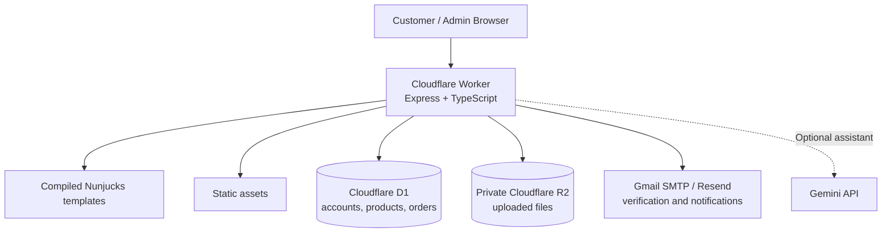

<div align="center">


# XPharma: Full-Stack Medical Product Platform

**A bilingual web application for exploring XPharma products, reserving orders, and managing payments and customer activity.**

[](https://xpharma-eg.com)

[](https://www.typescriptlang.org/)
[](https://expressjs.com/)
[](https://workers.cloudflare.com/)
[](https://developers.cloudflare.com/d1/)
[](https://developers.cloudflare.com/r2/)

</div>

---

## Table of Contents

- [Overview](#overview)
- [Key Features](#key-features)
- [System Architecture](#system-architecture)
- [Tech Stack](#tech-stack)
- [Project Structure](#project-structure)
- [Getting Started](#getting-started)
- [Application Routes](#application-routes)
- [Deployment](#deployment)
- [Testing](#testing)

---

## Overview

**XPharma** brings a product catalogue and reservation workflow together with an administration dashboard. Customers can browse in English or Arabic, verify their email, reserve products for collection, and choose cash on collection or an InstaPay transfer. Administrators manage products and orders, review payment proofs, and access customer and reservation reports.

The application runs on Cloudflare Workers with D1 for application data and a private R2 bucket for uploaded files. An optional Gemini-powered assistant answers questions about XPharma, its products, and the website.

---

## Key Features

### Customer Experience

- Responsive English and Arabic interface with dark mode
- Product browsing, search, pricing, and detailed product information
- Account registration, email verification, and a reservation dashboard
- Reservations with quantities and collection dates
- Cash on collection or InstaPay transfer with uploaded payment proof
- Order status tracking and replacement of rejected proofs
- Optional product and website information assistant

### Admin Experience

- Protected dashboard, customer search, and filtered reservation reports
- Product creation and editing, including bilingual content and images
- Product deletion and restoration while preserving order history
- Manual InstaPay review, order status updates, and payment proof downloads
- Order activity and previous proof history

### Operational Details

- Email notifications for reservations and cancellations
- Session-based authentication and CSRF protection
- Private storage for payment proofs
- Discount code support and scheduled cleanup of expired records

InstaPay payments are reviewed manually: staff must confirm receipt with InstaPay or the bank. A screenshot alone is not proof of payment, and cancelling an order does not automatically issue a refund.

---

## System Architecture



The assistant sends questions and product information to Google, without chat history or customer account data. It is intended for general product and website information, not diagnosis, prescribing, or personalised medical advice. See the [Cloudflare guide](cloudflare/README.md#customer-assistant) for configuration and limitations.

---

## Tech Stack

| Layer | Technologies |
|---|---|
| Backend | TypeScript, Express, Cloudflare Workers |
| Database | Cloudflare D1 and SQL migrations |
| File storage | Cloudflare R2 |
| Frontend | HTML, CSS, JavaScript, Nunjucks templates |
| Authentication | Sessions, email verification, bcrypt |
| Email | Gmail SMTP or Resend |
| Assistant | Gemini API, optional |
| Testing | Node.js test runner, Playwright |

---

## Project Structure

```text
XPharma-FullStack-Pharmacy-Platform/
|-- cloudflare/
|   |-- src/                 # Routes, authentication, orders, email, and assistant
|   |-- migrations/          # D1 schema migrations
|   |-- data/                # Product information
|   |-- scripts/             # Admin creation and template compilation
|   |-- generated/           # Compiled templates used by the Worker
|   `-- *.test.mjs           # API, browser, assistant, and SMTP tests
|-- templates/               # Customer, admin, and shared page templates
|-- static/                  # CSS, JavaScript, and images
|-- .dev.vars.example        # Local configuration template
|-- wrangler.jsonc           # Local Worker configuration
|-- wrangler.production.jsonc # Production Worker configuration
`-- package.json             # Dependencies and scripts
```

---

## Getting Started

### Prerequisites

- A current Node.js LTS release and npm
- Gmail SMTP or Resend credentials for real email delivery

### 1. Clone and install

```bash
git clone https://github.com/YoussefMohAttia/XPharma-FullStack-Pharmacy-Platform.git
cd XPharma-FullStack-Pharmacy-Platform
npm ci
```

On Windows, use `npm.cmd` if PowerShell's execution policy blocks `npm`.

### 2. Configure local secrets

Copy `.dev.vars.example` to `.dev.vars` and set a unique random `SESSION_SECRET` of at least 32 characters. Configure Gmail or Resend to deliver verification codes and notifications. The optional assistant also requires `GEMINI_API_KEY` and `GEMINI_MODEL`.

See the [local configuration guide](cloudflare/README.md#local-setup) for provider settings. Keep `.dev.vars` private and never commit it.

### 3. Initialize and run

```bash
npm run db:local
npm run dev:cloudflare
```

Open the local URL printed by Wrangler. Local D1 and R2 data are stored under `.wrangler/`. The database starts with a product catalogue and no administrator; follow the [administrator setup instructions](cloudflare/README.md#administrator) to create one.

After changing files in `templates/`, regenerate the compiled templates with `npm run templates`.

---

## Application Routes

| Route | Description |
|---|---|
| `/` | Home page and product catalogue |
| `/about` | Company information |
| `/customer/search` | Search products |
| `/customer/products/:id` | Product details |
| `/customer/register` and `/customer/login` | Customer account access |
| `/customer/dashboard` | Customer reservations |
| `/admin/login` and `/admin/dashboard` | Administrator access and dashboard |
| `/admin/products` | Product management |
| `/admin/customers` and `/admin/reports` | Customer and reservation reports |
| `/api/health` and `/api/products` | Health and product endpoints |
| `/api/assistant` | Optional customer assistant endpoint |

---

## Deployment

The production configuration uses Cloudflare Workers, D1, and a private R2 bucket. Provision resources, apply migrations, configure Worker secrets, and verify email delivery before serving customers. See [Cloudflare setup](cloudflare/README.md#cloudflare-resources) for resource and secret configuration.

Run `npm ci`, `npm run templates`, `npm run typecheck`, and `npm run test:smtp` before deploying. Deploy with `npx wrangler deploy --config wrangler.production.jsonc` after configuring the production resources and secrets. Keep the R2 bucket private and never run the test suite against the production database.

---

## Testing

```bash
npm run typecheck
npm run test:smtp
```

The repository also provides `npm run test:api` and `npm run test:browser`. API tests require an isolated local test configuration and running server; browser tests use the standard Windows Chrome installation path. Follow the [test setup](cloudflare/README.md#tests) before running them, and never point tests at the production database.

---

<div align="center">

**Built to support XPharma's product discovery and reservation workflow.**

</div>
